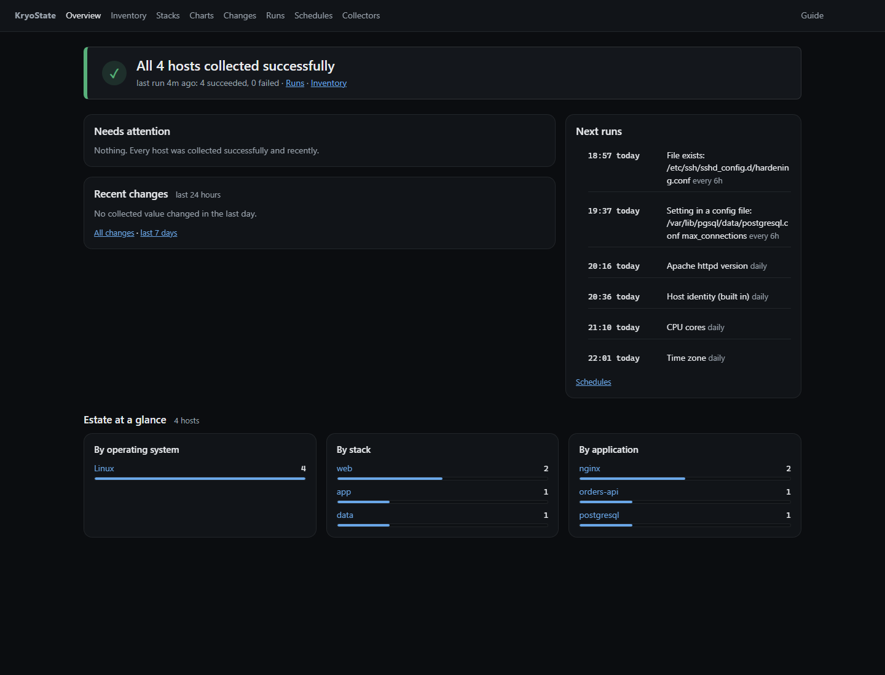
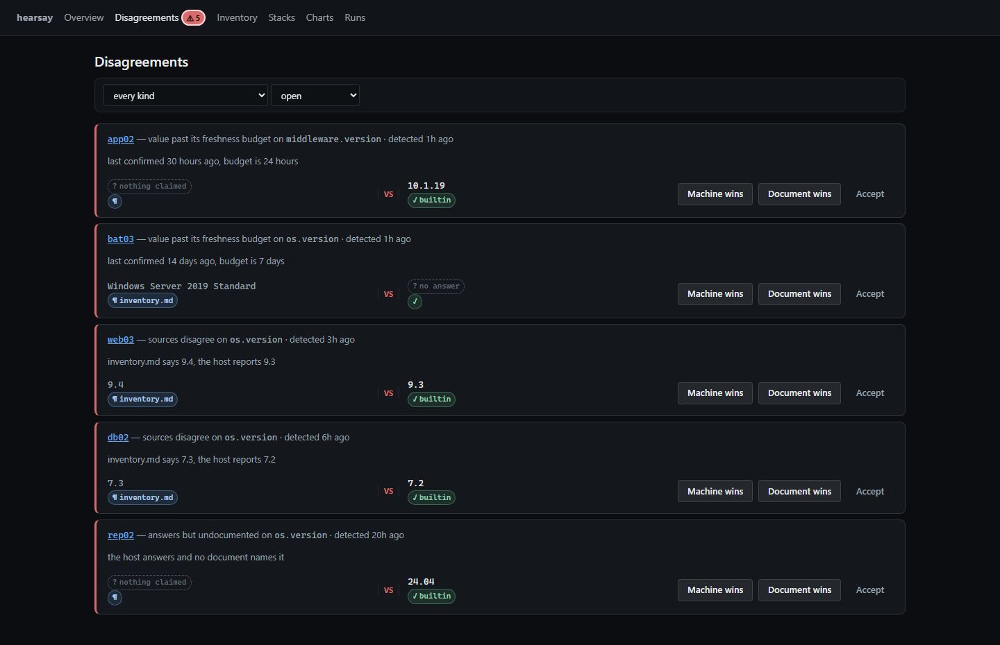
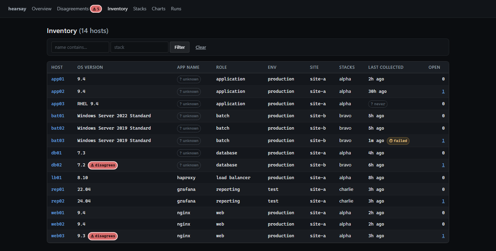
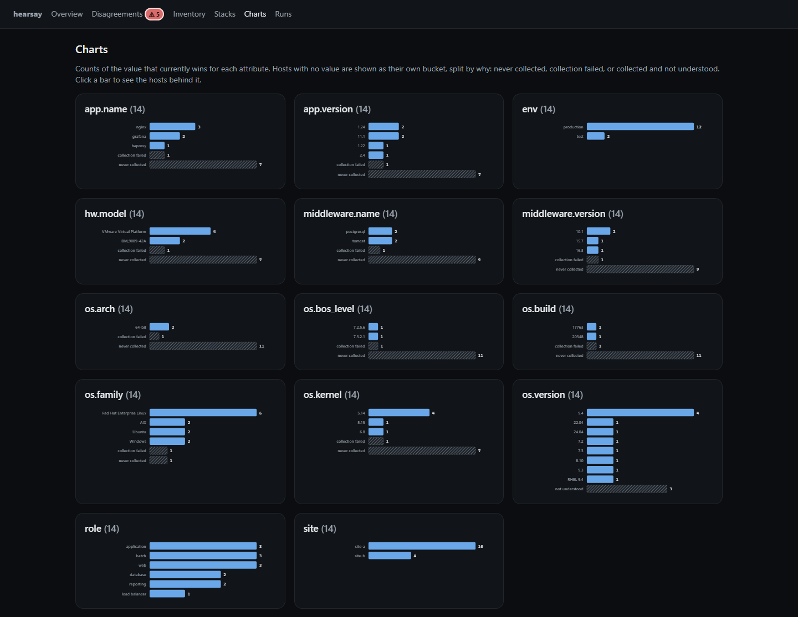
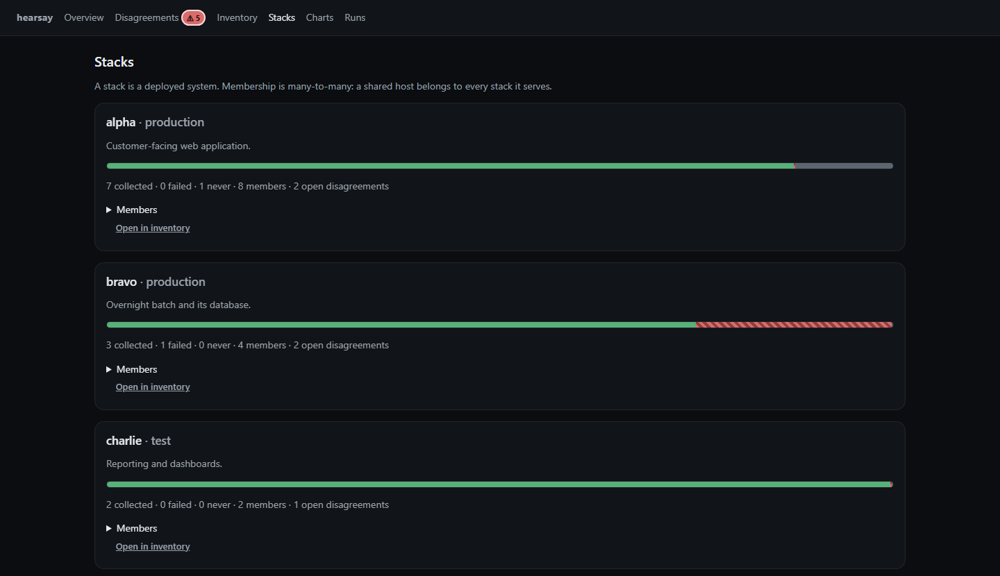
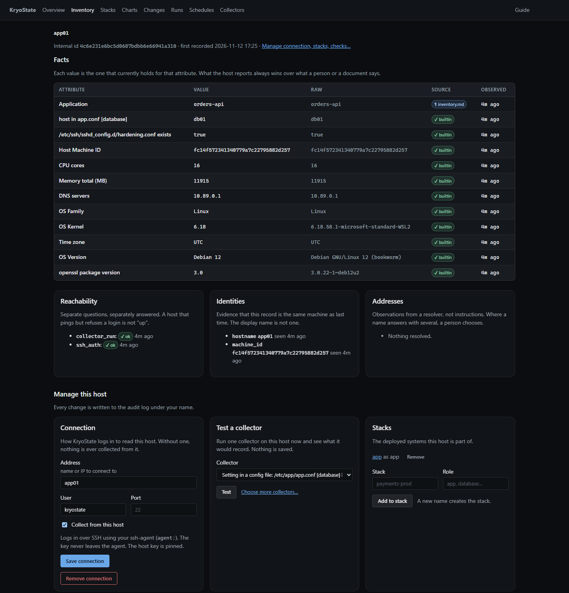

# hearsay

hearsay is a configuration management database for servers. It records what
your documents claim about each host. It connects to each host over SSH or
WinRM and records what the host reports. It then shows you where the two do
not agree.

The tool does not assume that a document is correct. It stores the document
claim and the machine report as separate statements, and keeps both.

## 1. Limitations

Read this section before you install the tool.

- The tool does not discover hosts. You supply the list. The tool does not
  scan the network.
- The tool has no authentication and no authorisation. Bind it to localhost,
  or put an authenticating proxy in front of it. Refer to
  [docs/threat-model.md](docs/threat-model.md).
- The tool does not change your hosts. The supplied commands are read-only.
  The tool does not check commands that you add.
- The tool does not replace monitoring. It records probe results. It does not
  send alerts.
- The tool does not map dependencies. Hosts belong to a stack because you put
  them in it.
- The web interface has no CSRF token on the forms that change data.

## 2. Description

### 2.1 Assertions

The database holds no current value. Each value is an assertion with five
parts: the item, the attribute, the value, the source, and the time of
observation. Assertions are append-only.

A document that claims one release and a host that reports another produce two
assertions. Neither one overwrites the other. A SQL view ranks the assertions
and selects the value to show. The other assertions stay in the database and
stay queryable.

### 2.2 Precedence

Precedence is set for each attribute, in the `precedence` table. The default
ranks are:

| Source kind | Rank |
|---|---|
| collector | 10 |
| human | 20 |
| dns | 30 |
| document | 40 |
| derived | 90 |

A lower rank wins. Three attributes have different defaults, because a machine
cannot report them: `env`, `site` and `owner` rank a human first. A derived
source is barred from `env` and `site`.

When two sources of equal rank disagree, the source that confirmed its value
most recently wins.

### 2.3 Collectors

A collector runs one command and returns bytes. A collector does not
interpret the bytes. Two separate steps interpret them, and you can repeat
either step against the database:

- **Parsing** takes a substring out of the command output. The tool stores the
  command output, so the `reparse` command corrects a rule that read the wrong
  line.
- **Normalisation** converts the substring into a comparable value. Rules are
  data. The `renormalize` command applies corrected rules to values already
  collected.

Neither command connects to a host. You can therefore correct a value for a
host that no longer exists.

### 2.4 Identity

The identifier of an item is opaque. The tool treats a hostname as evidence of
identity, and does not use it as the key. Hostnames repeat between sites, and
they are reused. When a name matches more than one item, the tool reports an
ambiguous identity instead of selecting one.

### 2.5 Probes

The database has no "last seen" column. Each probe is a separate event with
its own result. The probe kinds are `tcp`, `ssh_auth`, `winrm_auth`,
`collector_run`, `resolve` and `health`.

The tool does not send ICMP. A raw socket needs elevated privilege, which this
tool does not request. The schema reserves the `icmp` probe kind for results
from another system, but no command accepts one at present.

### 2.6 Unknown values

A host with no value for an attribute falls into one of three buckets:

| Bucket | Cause | Action |
|---|---|---|
| never collected | No collection has asked this host for this attribute | Add a connection profile |
| collection failed | The last collector run on this host failed | Repair the access |
| not understood | The host answered and no rule read the answer | Report a bug against this tool |

Charts show these buckets. The bars total the number of active hosts.

Refer to [docs/adr/](docs/adr/) for the reasoning behind each decision above.

## 3. Attributes

Attributes are names, not columns. To add an attribute, you do not change the
schema and you do not change the code.

The supplied collectors produce these attributes:

| Attribute | Platforms |
|---|---|
| `os.family` | AIX, Linux |
| `os.version` | AIX, Linux, Windows |
| `os.kernel` | Linux |
| `os.build`, `os.arch` | Windows |
| `os.bos_level`, `host.wpar` | AIX |
| `host.machine_id` | Linux, Windows |
| `hw.model` | AIX, Linux |
| `hw.serial` | AIX, Windows |

All other attributes come from your documents, your own collector
specifications, or your own external programs. You choose the names.
Application name, application version, role and middleware version are
attributes of this kind.

## 4. Installation

The tool needs Go 1.27.1 or later. Use Go 1.27.2 or later if you can: earlier
1.27.x releases are missing `html/template` escaping fixes. See
`docs/threat-model.md` for the findings and how to check them yourself.

```sh
go build ./cmd/hearsay
```

The SQLite driver is pure Go, so cgo is not necessary. The HTML templates, the
CSS and the JavaScript are compiled into the binary. The binary needs no
network access to serve its own interface.

## 5. Operation

### 5.1 Quick start

```sh
# 1. Record a host.
./hearsay host -name appnode1 -fqdn appnode1.example.invalid

# 2. Tell the tool how to reach it. Use the id printed by step 1.
./hearsay target -ci <id> -address appnode1.example.invalid \
    -transport ssh -user svc-ro -credential agent:

# 3. Or import a document you already have.
./hearsay import -name inventory.md -map ./mapping.json inventory.md

# 4. Collect, then compare the sources.
./hearsay collect
./hearsay detect

# 5. Define a health check and run it.
./hearsay check -ci <id> -name https \
    -http https://appnode1.example.invalid/health
./hearsay check -run

# 6. Read the results.
./hearsay serve -addr 127.0.0.1:8099
```

### 5.2 Commands

Run `hearsay -h` for the full list, and `hearsay <command> -h` for the flags of
one command.

| Command | Function |
|---|---|
| `import` | Reads a Markdown or CSV document and records its claims |
| `host` | Adds a host. `-retire` marks one gone and keeps its history |
| `target` | Adds or lists a connection profile |
| `stack` | Defines a stack and adds members |
| `secret` | Manages credential references |
| `collect` | Connects to each enabled target and records what it reports |
| `check` | Defines and runs liveness checks |
| `resolve` | Records the DNS answer for each host |
| `detect` | Compares the sources and raises disagreements |
| `reparse` | Applies current parse rules to stored command output |
| `renormalize` | Applies current normaliser rules to collected values |
| `evidence` | Lists or deletes stored command output |
| `serve` | Runs the web interface |
| `export`, `restore` | Writes and reads the whole database as JSON |

### 5.3 Custom collectors

A collector specification is a command, a parse rule and an attribute name:

```sh
./hearsay collect -collectors ./my-collectors.json
```

An external collector is a program that you supply:

```sh
./hearsay collect -externals ./my-externals.json
```

The tool runs the external program on the machine that runs hearsay, once for
each host. The program receives `HEARSAY_TARGET`, `HEARSAY_ADDRESS`,
`HEARSAY_SCHEMA`, `PATH`, and the variables that its own definition lists. It
receives nothing else, and it receives no credential. On Windows the Go
runtime also supplies `SystemRoot`, because a process without that variable
cannot load a DLL.

The program writes one JSON envelope to standard output:

```json
{
  "schema": "hearsay.facts/v1",
  "collector": "example",
  "status": "ok",
  "facts": [
    {"key": "product.home", "value": "/opt/product", "type": "path"},
    {"key": "product.version", "value": "4.2.1", "type": "version", "scope": "instance-a"}
  ]
}
```

The tool validates the envelope and accepts or rejects all of it. It does not
accept the valid facts from an invalid envelope. A rejected envelope makes the
defect visible.

## 6. Credentials

Each host can use a different credential. The database stores a reference. It
never stores key material.

| Reference | Resolved through |
|---|---|
| `agent:` | ssh-agent. No key enters this process |
| `keyring:service/account` | The operating system credential store |
| `file:/path/key` or `file:/path/key.age` | A file, decrypted with age if it is encrypted |
| `exec:/path/helper arg` | A program that prints the secret |
| `env:VAR_NAME` | An environment variable. This is the weakest option |

Prefer `agent:`. A stolen database file discloses the inventory. It does not
contain credentials.

An `agent:` reference with no address uses `SSH_AUTH_SOCK`. On Windows it uses
the named pipe of the OpenSSH agent, because Windows sets no such variable. To
use a different agent, give its address: `agent:/path/to/socket`.

To open an age file, set `HEARSAY_AGE_IDENTITY` to the path of the identity.
Keep that identity in a different place from the file it opens.

`hearsay secret -set service/account` reads the secret from standard input. It
has no flag that accepts a secret, so the secret stays out of the shell history
and out of the process list.

WinRM connects over HTTPS only. There is no flag to downgrade it.

## 7. Stored command output

The tool stores up to 8 KB of the output of each command. It keeps the latest
copy for each combination of host, collector specification and scope. This
stored output is what lets `reparse` correct a parse rule without a connection
to a host.

The tool stores the output only when the command ran and exited zero. It also
stores the output when the command ran and no parse rule read it, because that
is the case that `reparse` exists to repair. It discards the output of a
command that failed.

The supplied commands read release files and version strings. They run on your
hosts, so confirm what their output contains:

- `hearsay evidence -show` prints the stored output.
- `hearsay evidence -forget` deletes it.
- `collect -no-evidence` does not store it. A later parse rule correction then
  needs a second pass over the estate.

## 8. Interface

The interface is server-rendered HTML with HTMX. The charts are SVG drawn in
Go. Each bar links to the hosts that it counts.

The URL holds the filter state. Two people who open the same URL see the same
view.

The screens below show invented data.

The overview shows coverage counted from probes and collector runs, a button
that starts a collection, and the open disagreements.



The disagreements page shows one card for each open disagreement. A card names
the attribute, states both claims with their sources, and offers the three
decisions: the machine wins, the document wins, or the value is accepted.



The inventory shows one row for each host. You can filter by name or by stack.
A value that no source claims is marked unknown, not left blank.



The charts page shows one chart for each attribute that has more than one
value. Hosts with no value get their own bar, divided by cause: never
collected, collection failed, or collected and not understood. Attributes with
close to one value per host are listed instead of charted.



The stacks page shows one card for each stack, with its collection coverage and
its open disagreements. A host that serves two stacks appears in both.



The host page shows the value that currently wins for each attribute, with the
raw string, the source, and the time of observation. Where sources disagree,
every claim is listed. Reachability, identity evidence, addresses and
connection details are separate cards.



## 9. Verification

```sh
go test ./... -race
```

The tests check these properties:

- The parsers run against the fixture files in `testdata/fixtures`, which hold
  command output for AIX, Linux and Windows. The hostnames and the serial
  numbers in them are not real.
- The importer reproduces the totals that a document states about itself.
- Export, restore into an empty database, then export again produces an
  identical file.
- The parsers are fuzzed. Malformed input must not panic.
- The handlers return the expected HTML and the `Vary: HX-Request` header.
- An external collector runs as a subprocess and cannot read the environment
  of the parent process.
- An incorrect parse rule is corrected, and the value is derived again, with no
  host reachable in the test.
- A failed DNS lookup is not recorded as a missing DNS record.
- A failed DNS lookup does not close an open finding about a host.
- Of two sources of equal rank, the source that confirmed its value most
  recently wins.

## 10. Status

Early. `export` and `restore` round-trip, and a schema change will include a
migration. Known gaps are in this file and in the threat model.

## 11. Licence

MIT. Refer to [LICENSE](LICENSE).
