# KryoState

This file is the entry point for KryoState. It is for persons who install
the tool and use the command line. For tutorials, read the
[user guide](docs/user-guide.md). The web interface also shows the user guide
at `/guide`.

KryoState is an inventory of hosts. You give the list of hosts, their stacks,
the role of each host in a stack, and the application of each host. KryoState
connects to each host over SSH or WinRM and records all other values from what
the host reports. A value that the host reports always wins over a value from
a person or a document. KryoState keeps each value with its source and its
time, so the history of each value stays in the database.

## Limits

**WARNING:** The web interface and the JSON API have no login. A person who
can open the web interface can change the inventory. Keep the listen address
on `127.0.0.1`, or put a proxy that asks for a login in front of it. Refer to
[docs/threat-model.md](docs/threat-model.md).

- KryoState does not find hosts. You must give the list of hosts.
- KryoState does not change hosts. The supplied commands only read values.
  KryoState does not examine the commands that you add.
- KryoState does not send alerts. It records the results of checks.
- KryoState does not find dependencies. A host is in a stack only if you put
  it in that stack.

## Install

KryoState is one binary. The binary contains the web interface and a pure Go
SQLite driver. Release builds are available for Linux (amd64, arm64), macOS
(amd64, arm64) and Windows (amd64). There is no AIX build, but KryoState can
collect from AIX hosts. To run KryoState as a service, refer to
[docs/operations.md](docs/operations.md).

### Release archive

1. Download `kryostate_<version>_<os>_<arch>.tar.gz` (`.zip` for Windows) and
   `checksums.txt` from the
   [releases page](https://github.com/KalebHawkins/kryostate/releases).
2. Make sure that the checksum is correct.
3. Put `kryostate` in a directory on your `PATH`.

```sh
sha256sum -c --ignore-missing checksums.txt
tar -xzf kryostate_*_linux_amd64.tar.gz kryostate
sudo install kryostate /usr/local/bin/
kryostate version
```

The archive also contains this file, the licence, the docs and the systemd
units.

### Packages

The `.deb` and `.rpm` packages install the binary and a systemd service. The
service runs as the `kryostate` user and listens on `127.0.0.1:8099`. The
package does not start the service.

```sh
sudo apt install ./kryostate_<version>_amd64.deb        # Debian, Ubuntu
sudo dnf install ./kryostate-<version>-1.x86_64.rpm     # RHEL, Alma, Fedora
sudo systemctl enable --now kryostate
```

### Container

The images are for amd64 and arm64. The database is in the `/data` volume.

```sh
podman run -d --name kryostate -p 127.0.0.1:8099:8099 -v kryostate-data:/data \
  ghcr.io/kalebhawkins/kryostate:latest
```

Refer to [docs/operations.md](docs/operations.md#container) for the SSH agent
and the backups of a container.

### Go

You must have Go 1.27.1 or later. Use Go 1.27.2 or later if possible,
because earlier 1.27 releases do not have the `html/template` escaping fixes.

```sh
CGO_ENABLED=0 go install github.com/KalebHawkins/kryostate/cmd/kryostate@latest
```

To build from the source:

```sh
git clone https://github.com/KalebHawkins/kryostate && cd kryostate
CGO_ENABLED=0 go build ./cmd/kryostate
```

## Quick start

To try KryoState on test hosts first, refer to the lab in the
[user guide](docs/user-guide.md).

1. Add a host:

   ```sh
   kryostate host add web01 --fqdn web01.example.com
   ```

2. Add a target for the host. KryoState connects to the fqdn of the host, or
   to its name if it has no fqdn:

   ```sh
   kryostate target add web01 --user svc-ro
   ```

   If you do not give `-c`, KryoState uses the credential of your other
   targets for that user. If there is none, it uses a stored password for
   the user, then `agent:` (ssh-agent).

   If the host accepts only a password, add `--password`. KryoState asks for
   the password and keeps it in the operating system credential store:

   ```sh
   kryostate target add web01 web02 --user svc-ro --password
   ```

3. Collect the values and run the checks:

   ```sh
   kryostate refresh
   ```

4. Read the result:

   ```sh
   kryostate host list
   kryostate host show web01
   ```

5. Start the web interface. While it runs, each collector runs on its
   schedule:

   ```sh
   kryostate serve --addr 127.0.0.1:8099
   ```

6. Open `http://127.0.0.1:8099` in a browser.

To add many hosts at one time, use a YAML or JSON file:

```sh
kryostate import --example > hosts.yaml
kryostate import hosts.yaml --dry-run
kryostate import hosts.yaml
```

## Commands

Each command is a noun and a verb, for example `kryostate host add`. Flags
have two dashes (`--db`). Run `kryostate <command> --help` to see all flags
of a command.

A command that takes a host accepts the name, the fqdn, another identity
value, the id, or the first six or more characters of the id. If a name
matches more than one host, the command stops and shows each match.

### Everyday

| Command | Function |
|---|---|
| `refresh` | Runs `collect`, then the checks. `--resolve` does a DNS lookup of each host first. `--no-checks` does not run the checks |
| `serve` | Starts the web interface and the collection schedules. `--no-schedule` stops the schedules |
| `changes [host]` | Lists the values that changed, newest first, as on the **Changes** page. `--since` (default `24h`; days as `7d`), `--attr`, `--limit`, `--json` |
| `show` | The same as `host show` |
| `set` | The same as `host update` |

### Hosts

| Command | Function |
|---|---|
| `host list` (`host ls`) | Shows the hosts. `-q` filters with a query, `--stack` with a stack, `--cols` sets the attribute columns, `--json` shows JSON in the format of `/hosts.json` |
| `host show <host>` | Shows the values, reachability and targets of one host. `--at 2026-03-01` shows the values at the end of that day |
| `host add <name>` | Adds a host. `--fqdn` gives its fully qualified name |
| `host update <host> application=NAME stack=NAME role=ROLE` | Records the application, stack or role of a host. You cannot set other values. `--reason` adds a note to the audit log |
| `host disable <host>...` | Stops all contact with the hosts: no collection, external collectors, checks or DNS lookups. The hosts and their targets stay in the inventory. `--reason` is recorded |
| `host enable <host>...` | Starts contact with disabled hosts again, through the same targets |
| `host rm <host>...` | Deletes the hosts and all their values permanently. The audit log is kept. `--yes` does not ask for confirmation |
| `import <file>` | Adds or updates hosts, targets and stack memberships from a YAML or JSON file. Refer to [Import](#import) |

### Targets and credentials

| Command | Function |
|---|---|
| `target add <host>...` | Adds a target: transport (`-t ssh` or `-t winrm`), address (`-a`), port (`-p`), user (`-u`) and credential (`-c`). `--password` asks for a password and stores it |
| `target update <host>...` | Changes the targets of the hosts. Only the flags that you give change |
| `target list` (`target ls`) | Shows the targets. It shows if each target is in use, disabled, or for a disabled host |
| `target rm <host>...` | Removes the targets of the hosts. The collected values stay |
| `target set-credential --for-user <user>` | Changes the credential of each target that logs in as `<user>`. Give `-c <ref>` or `--password` |
| `target forget-host-key <host>` | Removes the pinned host key. Use it only after a host was rebuilt |
| `secret list` | Shows the stored passwords, the number of connections that use each, entries made by mistake and references that are missing, with the commands to fix them. On macOS and Linux, shows only the keyring references in use |
| `secret set <service/account>` | Stores a secret in the operating system credential store. It also releases a hold on `keyring:service/account` |
| `secret delete <service/account>` | Removes a secret from the operating system credential store. `--entry <name>` removes an entry by the name that `secret list` shows, which also removes entries made by mistake |
| `secret test <ref>` | Resolves a credential reference and shows only if it worked |
| `secret holds` | Shows the password credentials that failed to log in, and the credentials that are on hold |
| `secret release <ref>` | Releases the hold on a credential reference, so that KryoState tries it again |

### Stacks, checks and rules

| Command | Function |
|---|---|
| `stack list` | Shows the stacks and the status of their members |
| `stack add <stack> [host[:role]...]` | Makes a stack, or adds hosts to a stack. `--file` reads a list of hosts, `-q` adds the hosts that match a query, `--create` adds unknown hosts |
| `stack update <stack>` | Changes the description, owner or environment of a stack |
| `stack rm <stack> <host>...` | Removes hosts from a stack |
| `stack delete <stack>` | Deletes a stack. The hosts and their values stay |
| `check add <host> <name>` | Adds a check: `--tcp host:port` or `--http URL` with `--expect 2xx` |
| `check list <host>`, `check rm <host> <name>` | Shows or removes the checks of a host |
| `check` or `check run` | Runs all enabled checks. `--only` limits the hosts |
| `rules add <name> --expect <query>` | Makes a rule that tracks a rollout. `--scope` selects the hosts |
| `rules list`, `rules show <rule>`, `rules rm <rule>` | Shows the rules, shows the hosts that a rule waits for, or deletes a rule |
| `notify` | Sets the daily digest and its destinations: `list`, `add-webhook`, `add-email`, `rm`, `test`, `preview`, `set` |

### Collectors

| Command | Function |
|---|---|
| `collectors list` | Shows the collectors that run |
| `collectors catalog` | Shows the catalog collectors that you can enable |
| `collectors enable <name>` | Enables a catalog collector or a group. `--param`, `--key`, `--stacks` and `--where` set where and what it reads |
| `collectors disable <name>` | Disables a catalog collector |
| `collectors add <file.json>` | Stores your collectors in the database. `--dry-run` only examines the file. `--example` shows an example |
| `collectors rm <id>...` | Removes collectors that `collectors add` stored. The values stay |
| `collectors init` | Makes a `collectors.json` file next to the database |
| `collectors show <id>` | Shows a collector in the format of `collectors.json` |
| `collectors try <name>` | Tests a collector on `--host` or on `--sample` output. It records nothing |
| `collectors schedules` | Shows when each collector runs |
| `collectors schedule <id>` | Changes a schedule: `--every 6h`, `--at 02:00`, `--manual` or `--default` |

### Collection and maintenance

| Command | Function |
|---|---|
| `collect` | Connects to each enabled target and records the values. `--only` limits the hosts, `--transport` limits the transport |
| `resolve` | Does a DNS lookup of each host and records the result |
| `reparse` | Applies the current parse rules to the stored command output. It does not connect to hosts |
| `renormalize` | Applies the current normaliser rules to the collected values. It does not connect to hosts |
| `evidence list`, `evidence rm` | Shows or deletes the stored command output. `--show` shows the output |
| `export` | Writes the full database to a JSON file (`-o`) |
| `restore` | Loads a JSON file (`-i`) into an empty database |
| `version` | Shows the version, commit and build date (also `--version`) |
| `completion bash\|zsh\|fish\|powershell` | Shows a shell completion script |

### Import

`kryostate import` reads a YAML or JSON file. The file gives each host, its
fqdn, its application, its target and its stacks with a role. The `defaults`
section applies to the target of each host.

- KryoState examines the full file first. If there is an error, it writes
  nothing and shows each error with its line.
- `--dry-run` shows the changes and writes nothing.
- If you import the same file again, nothing changes.
- KryoState never removes hosts, targets or stack memberships that are not in
  the file.
- `--example` shows a file with comments. `--from-db` shows the current hosts
  in the same format.
- To read standard input, give `-` and `--format yaml` or `--format json`.

## Configuration

KryoState reads each setting from the first of these sources that has it:

1. The flag on the command line, for example `--concurrency 16`.
2. A `KRYOSTATE_` environment variable, for example `KRYOSTATE_DB` or
   `KRYOSTATE_HOST_TIMEOUT`.
3. The config file.
4. The default value.

The config file is `kryostate/config.yaml` in the user configuration
directory, for example `~/.config/kryostate/config.yaml`. `--config` or
`KRYOSTATE_CONFIG` gives a different file. The keys are flag names:

```yaml
db: /var/lib/kryostate/kryostate.db
concurrency: 16
serve:
  addr: 0.0.0.0:8099
  trusted-origin: https://cmdb.example.com
```

[docs/operations.md](docs/operations.md#configuration) shows all the settings.

At a terminal, KryoState shows tables with borders and colours. If you send
the output to a pipe or a file, the output is plain text in columns. Set
`NO_COLOR=1` to stop the borders and colours. Set `CLICOLOR_FORCE=1` to show
them in a pager, for example `less -R`.

## Credentials

The database keeps a reference to each credential. It never keeps a key or a
password.

| Reference | Source of the secret |
|---|---|
| `agent:` | ssh-agent (`SSH_AUTH_SOCK`, or the OpenSSH agent pipe on Windows). No key goes into KryoState |
| `agent:/path/to/socket` | A different ssh-agent |
| `keyring:service/account` | The operating system credential store. `--password` uses `keyring:kryostate/<user>` |
| `file:/path/key` | A key file. If the name ends in `.age`, KryoState decrypts it with the identity in `KRYOSTATE_AGE_IDENTITY` |
| `exec:/path/helper arg` | A program that prints the secret |
| `env:VAR_NAME` | An environment variable. This is the least safe type |

Use `agent:` if possible. WinRM uses HTTPS only. For the full procedure,
password logins and holds, read the [user guide](docs/user-guide.md). For the
risks, read [docs/threat-model.md](docs/threat-model.md).

## Web interface

The screens below are of the lab in the user guide. The
[user guide](docs/user-guide.md) tells how to use each page.

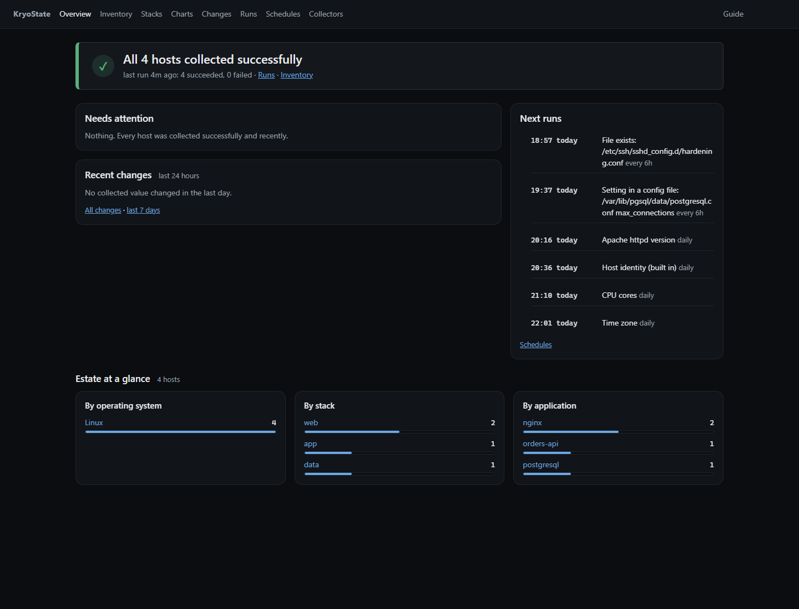

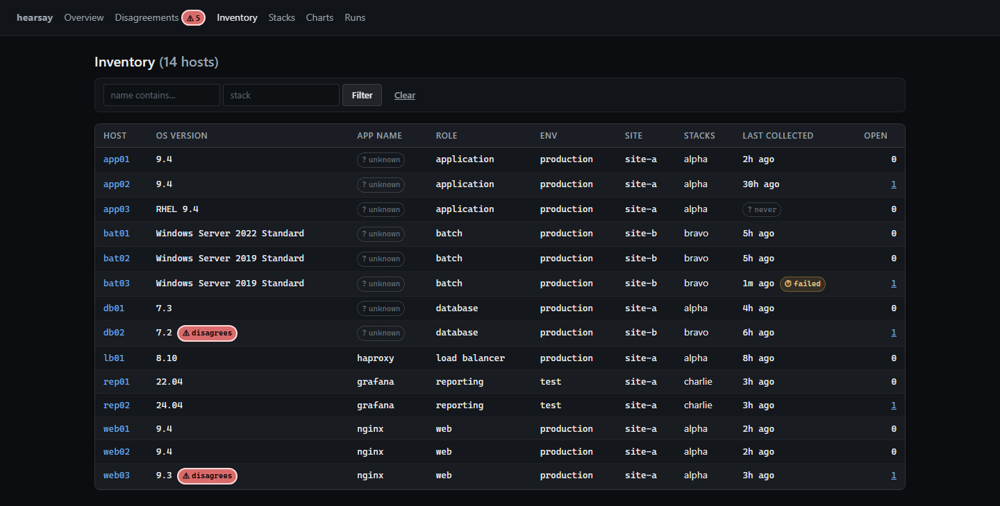

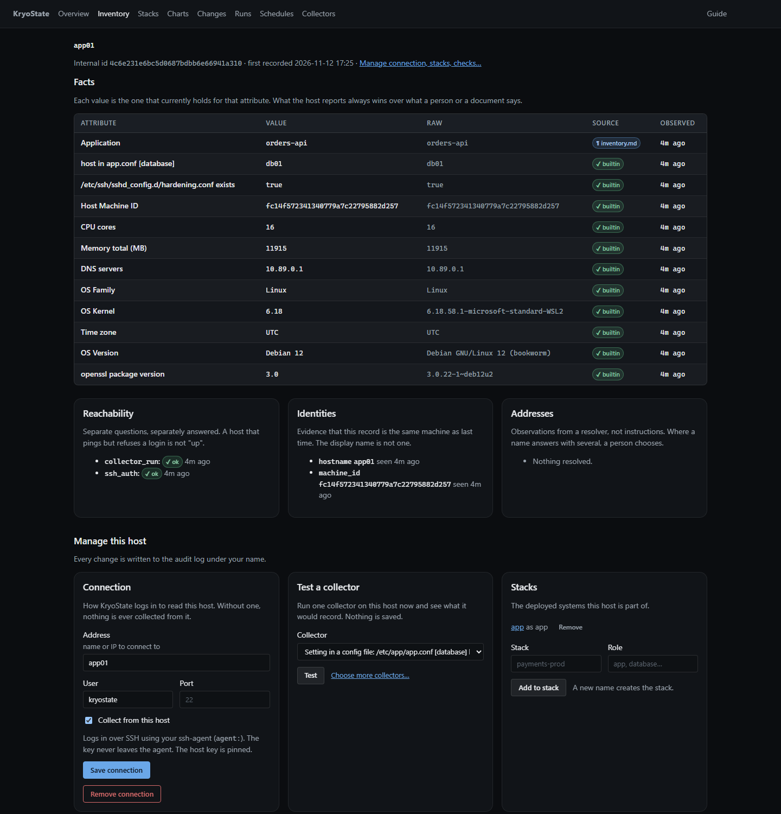

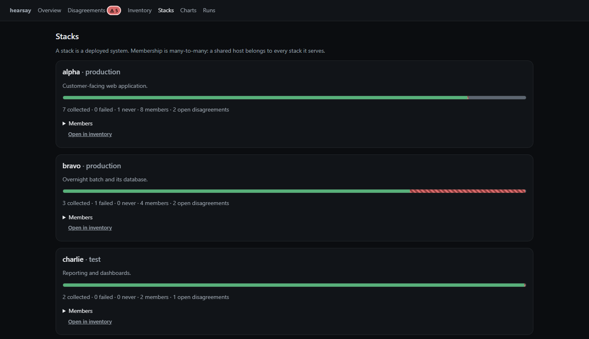

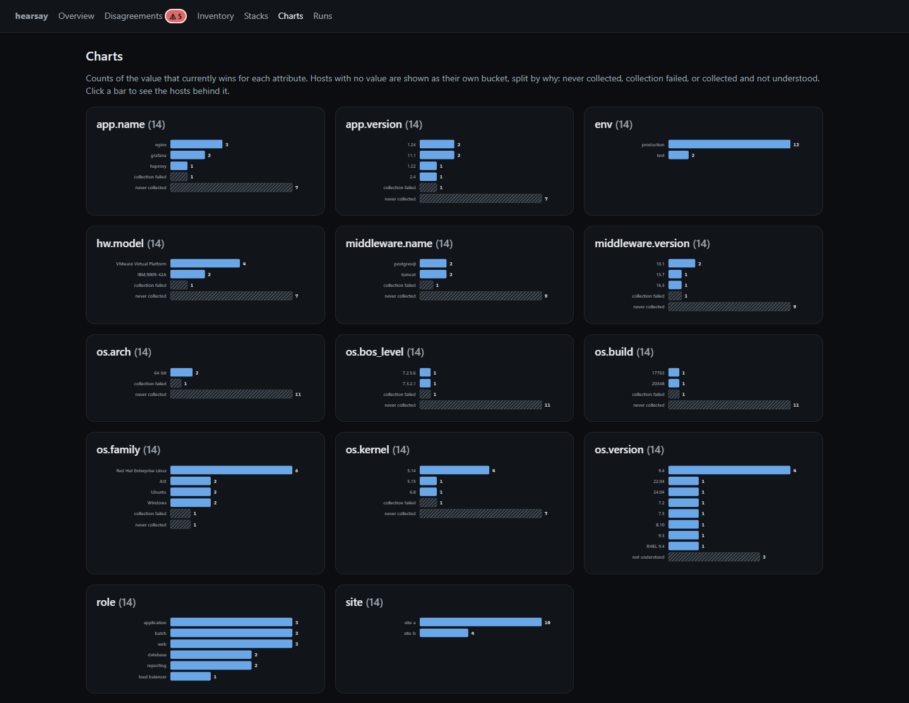

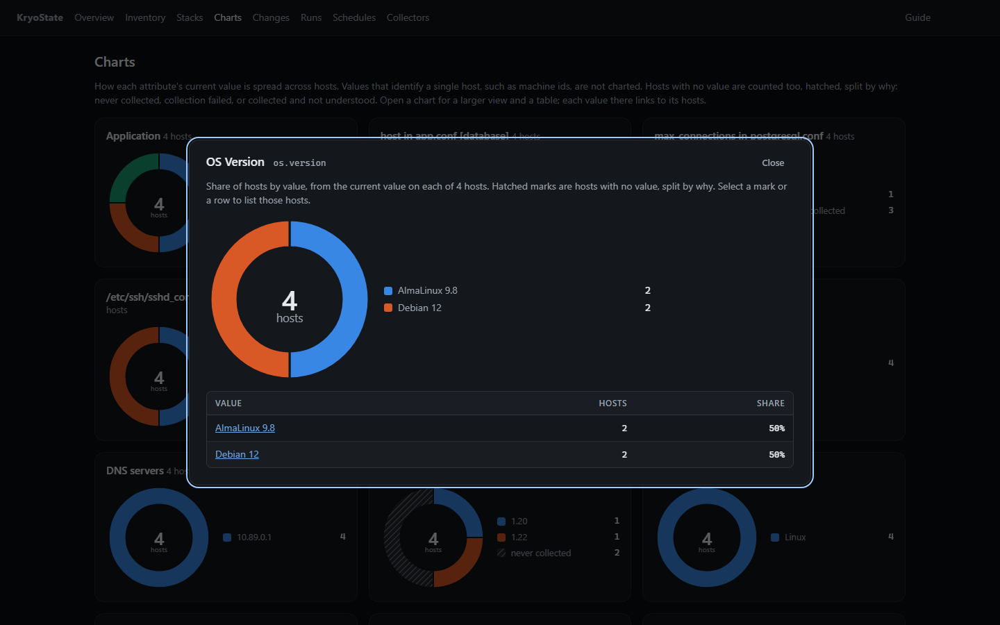

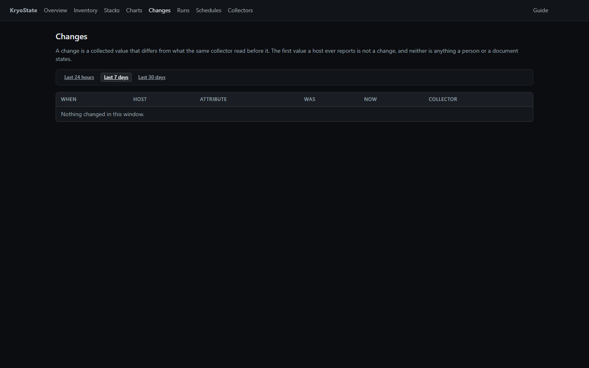

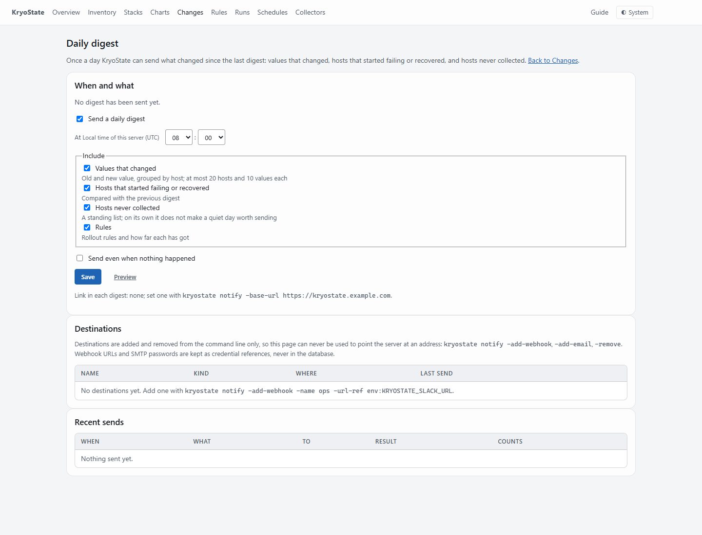

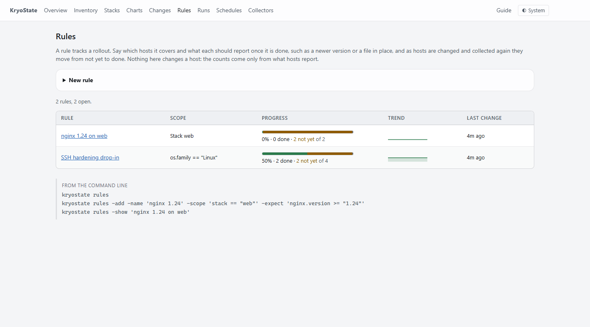

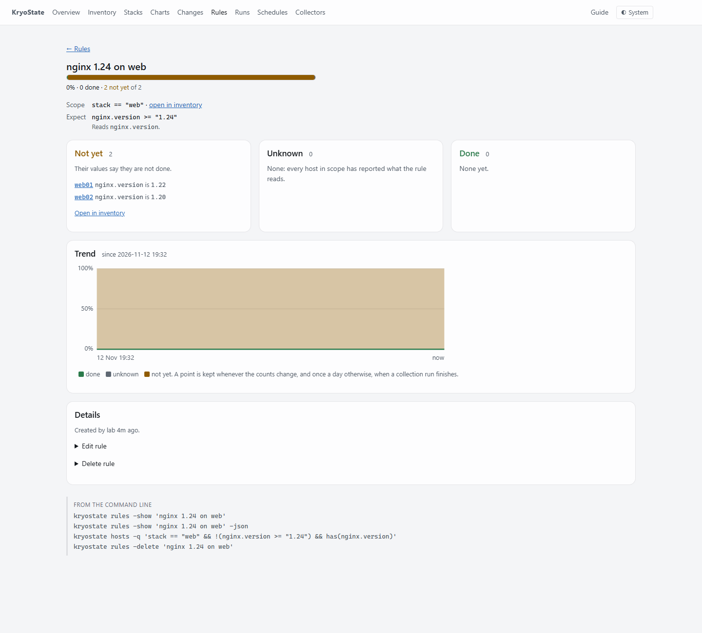

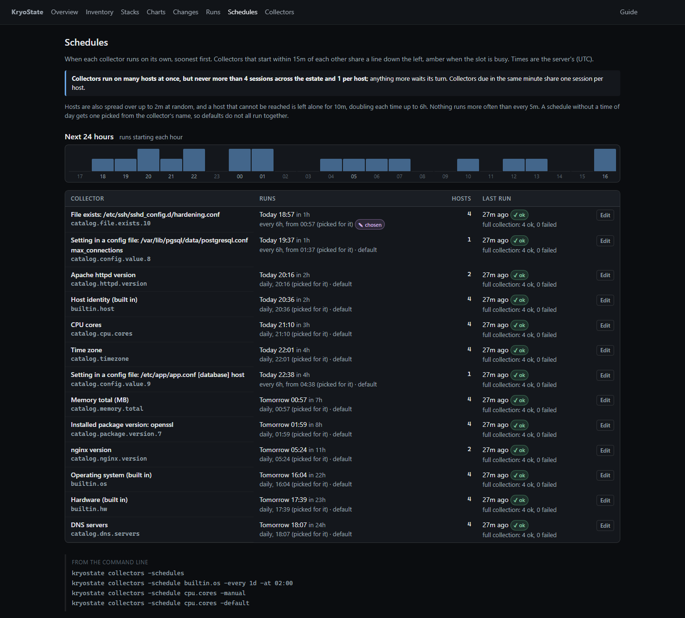

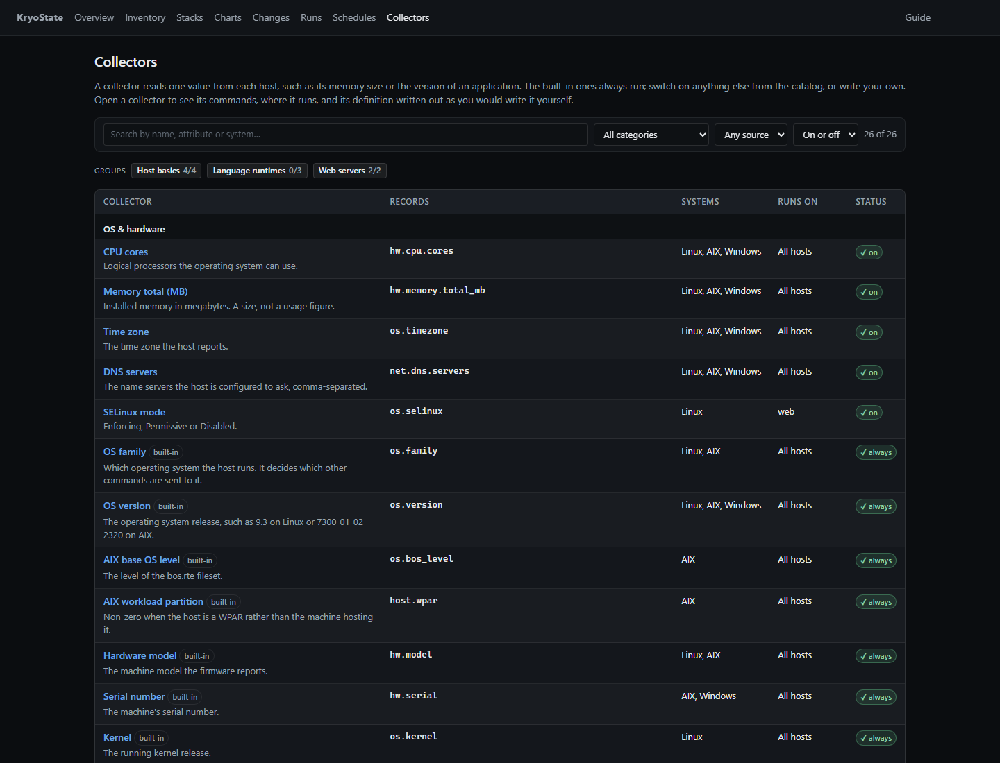

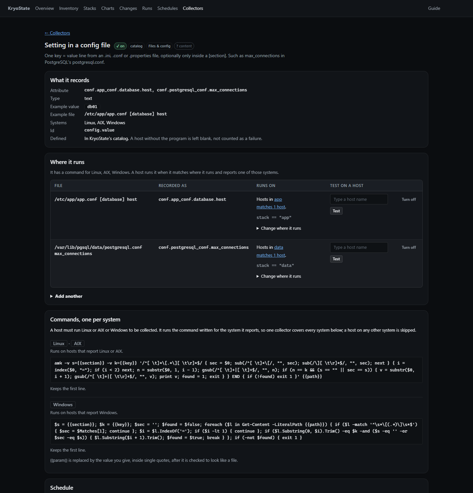

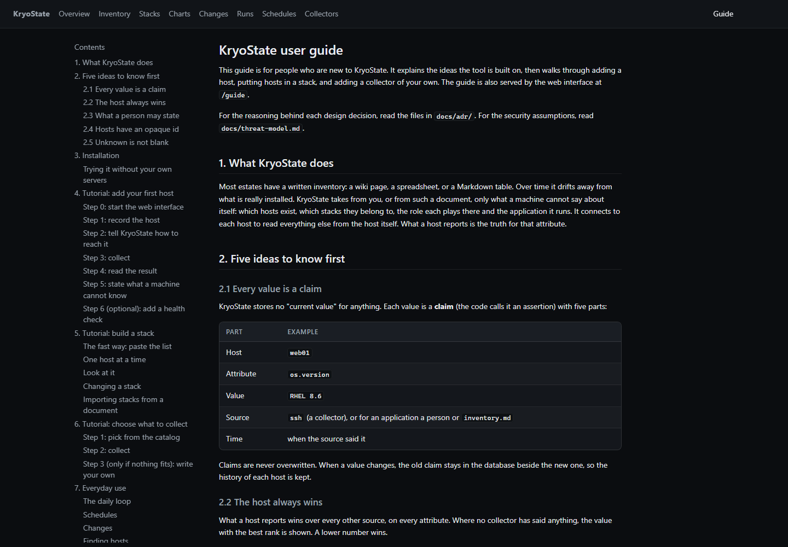

## Releases

The **release** workflow makes the releases.

- Each push to `main` that passes CI makes a patch release. The workflow
  adds one to the patch number of the newest `v*` tag. If there is no tag,
  the first release is `v0.1.0`.
- For a minor or a major release, push the tag yourself. Later automatic
  releases count up from that tag.

```sh
git tag v1.0.0 && git push origin v1.0.0
```

GoReleaser makes the archives, packages and images (`.goreleaser.yaml`). To
make all of them locally without a release, run
`goreleaser release --snapshot --clean`.

To run the tests:

```sh
go test ./... -race
```

## Documents

| Document | Contents |
|---|---|
| [docs/user-guide.md](docs/user-guide.md) | Concepts, tutorials, everyday tasks and troubleshooting |
| [docs/collectors.md](docs/collectors.md) | The catalog, and how to write your own collectors and external programs |
| [docs/queries.md](docs/queries.md) | The query language |
| [docs/api.md](docs/api.md) | The read-only JSON API |
| [docs/operations.md](docs/operations.md) | The service, backups, upgrades and settings |
| [docs/threat-model.md](docs/threat-model.md) | Security: credentials, transport and the web interface |
| [docs/adr/](docs/adr/) | The reasons for the design decisions |

## Licence

MIT. Refer to [LICENSE](LICENSE).
