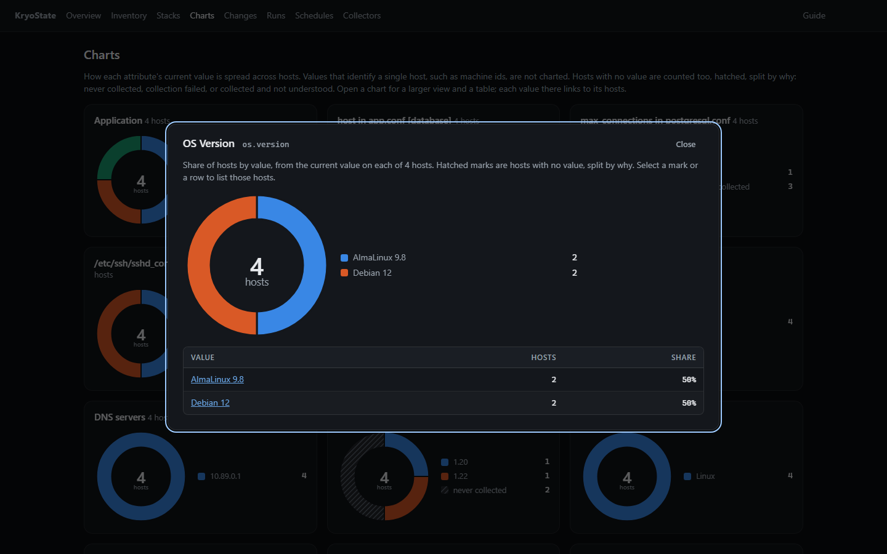
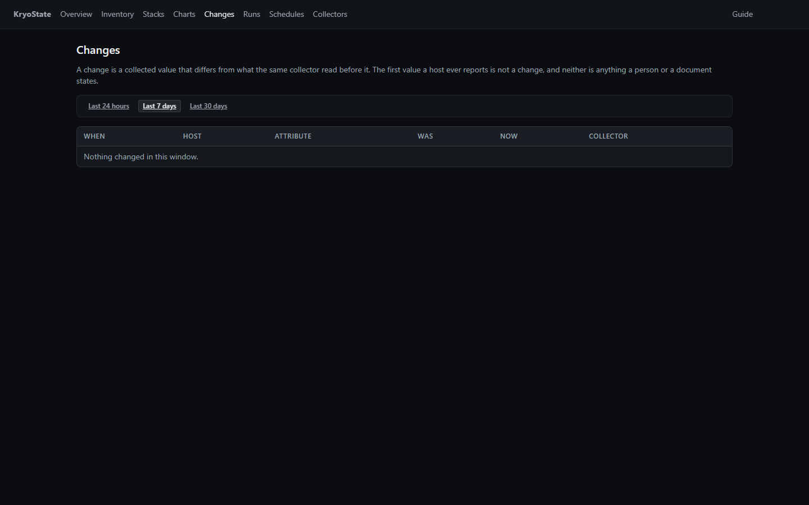
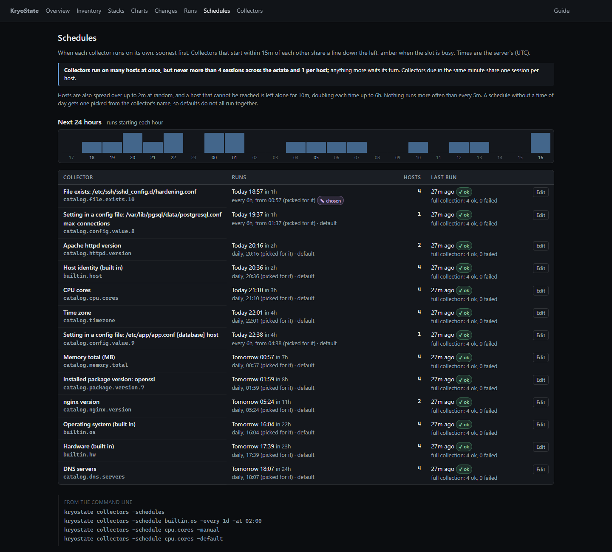
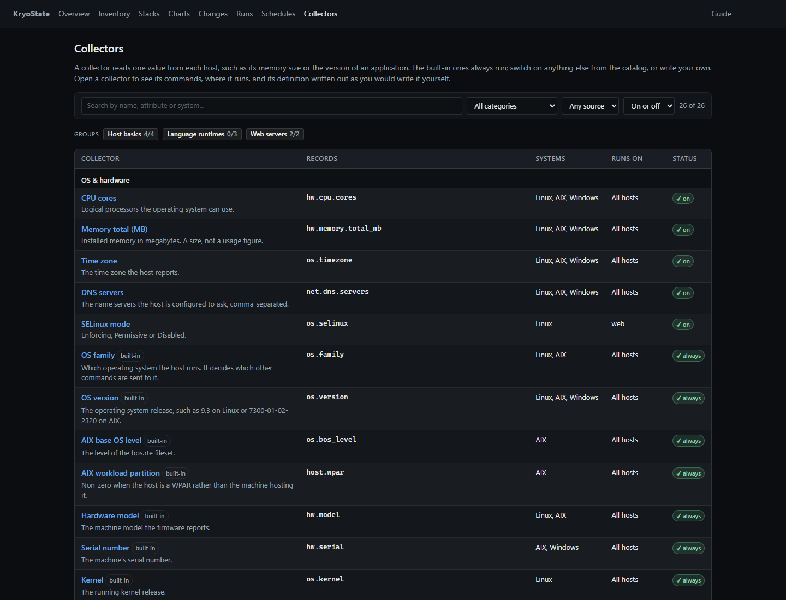
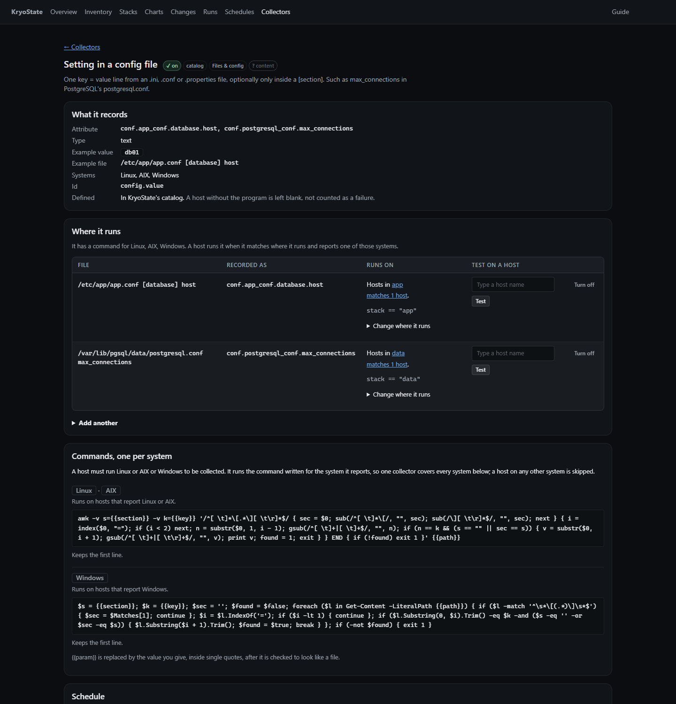
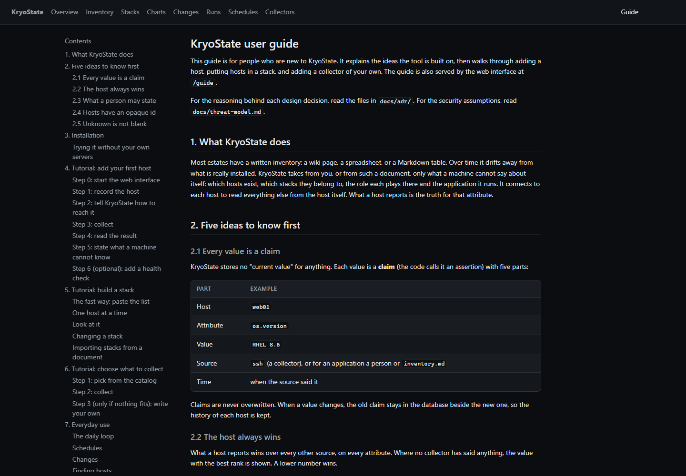

# KryoState

New to the tool? Start with the [user guide](docs/user-guide.md). It has
tutorials for adding a host, building a stack and adding a collector, and the
web interface serves it at `/guide`.

KryoState is a configuration management database for servers. You, or an
inventory document, say which hosts exist, which stacks they belong to, the
role each plays there and the application it runs. KryoState connects to each
host over SSH or WinRM and records everything else from what the host
reports. What a host reports is the truth for that attribute.

Every value is kept with its source and time, so the history of what changed
stays in the database.

## 1. Limitations

Read this section before you install the tool.

- The tool does not discover hosts. You supply the list. The tool does not
  scan the network.
- The tool has no authentication and no authorisation. Bind it to localhost,
  or put an authenticating proxy in front of it. Refer to
  [docs/threat-model.md](docs/threat-model.md).
- The tool does not change your hosts. The supplied commands are read-only.
  The tool does not check commands that you add.
- The tool does not replace monitoring. It records probe results. It does not
  send alerts.
- The tool does not map dependencies. Hosts belong to a stack because you put
  them in it.
- The web interface can add and change hosts, connections, stacks,
  applications and checks, switch catalog collectors on and off, change
  schedules, and start a collection. It refuses form submissions from other
  web sites, but it has no login: anyone who can reach it can change the
  inventory. It never takes a command, and it can only create connections
  that use ssh-agent.

## 2. Description

### 2.1 Assertions

The database holds no current value. Each value is an assertion with five
parts: the item, the attribute, the value, the source, and the time of
observation. Assertions are append-only.

A value that changes produces a second assertion. Neither one overwrites the
other. A SQL view ranks the assertions and selects the value to show. The
other assertions stay in the database and stay queryable.

### 2.2 Precedence

What a host reports always wins. A collected value outranks every other kind
of source on every attribute, whatever the `precedence` table says. Among the
other sources the default ranks are:

| Source kind | Rank |
|---|---|
| human | 20 |
| dns | 30 |
| document | 40 |
| derived | 90 |

A lower rank wins. A derived source is barred from `env` and `site`.

A person or a document may state only a host's application, and its stacks
with its role in each. Use `kryostate set <host> application=ledger`,
the form on the host page, or an imported inventory. Every other
attribute comes from the host.

When two sources of equal rank give different values, the source that
confirmed its value most recently wins.

### 2.3 Collectors

A collector runs one command and returns bytes. A collector does not
interpret the bytes. Two separate steps interpret them, and you can repeat
either step against the database:

- **Parsing** takes a substring out of the command output. The tool stores the
  command output, so the `reparse` command corrects a rule that read the wrong
  line.
- **Normalisation** converts the substring into a comparable value. Rules are
  data. The `renormalize` command applies corrected rules to values already
  collected.

Neither command connects to a host. You can therefore correct a value for a
host that no longer exists.

### 2.4 Identity

The identifier of an item is opaque. The tool treats a hostname as evidence of
identity, and does not use it as the key. Hostnames repeat between sites, and
they are reused. When a name matches more than one item, the tool reports an
ambiguous identity instead of selecting one.

### 2.5 Probes

The database has no "last seen" column. Each probe is a separate event with
its own result. The probe kinds are `tcp`, `ssh_auth`, `winrm_auth`,
`collector_run`, `resolve` and `health`.

The tool does not send ICMP. A raw socket needs elevated privilege, which this
tool does not request. The schema reserves the `icmp` probe kind for results
from another system, but no command accepts one at present.

### 2.6 Unknown values

A host with no value for an attribute falls into one of three buckets:

| Bucket | Cause | Action |
|---|---|---|
| never collected | No collection has asked this host for this attribute | Add a connection profile |
| collection failed | The last collector run on this host failed | Repair the access |
| not understood | The host answered and no rule read the answer | Report a bug against this tool |

Charts show these buckets, so each chart accounts for every active host.

Refer to [docs/adr/](docs/adr/) for the reasoning behind each decision above.

## 3. Attributes

Attributes are names, not columns. To add an attribute, you do not change the
schema and you do not change the code.

The supplied collectors produce these attributes:

| Attribute | Platforms |
|---|---|
| `os.family` | AIX, Linux |
| `os.version` | AIX, Linux, Windows |
| `os.kernel` | Linux |
| `os.build`, `os.arch` | Windows |
| `os.bos_level`, `host.wpar` | AIX |
| `host.machine_id` | Linux, Windows |
| `hw.model` | AIX, Linux |
| `hw.serial` | AIX, Windows |

All other attributes come from catalog collectors you switch on (section
5.3), your own collector specifications, or your own external programs. You
choose the names. Application version and middleware version are attributes
of this kind. People and documents supply only a host's application, and its
stacks and roles.

## 4. Installation

KryoState is one binary. The HTML templates, the CSS and the JavaScript are
compiled into it, the SQLite driver is pure Go, and it needs no network access
to serve its own interface. Pick whichever way of getting it suits the
machine. To run it as a service, with backups and upgrades, see
[docs/operations.md](docs/operations.md).

Release builds exist for Linux (amd64, arm64), macOS (amd64, arm64) and
Windows (amd64). There is no AIX build: the pure Go SQLite library has no AIX
port. KryoState still collects from AIX hosts; it cannot run on one.

**Release archive.** Download `kryostate_<version>_<os>_<arch>.tar.gz` (or
`.zip` for Windows) from the
[releases page](https://github.com/KalebHawkins/kryostate/releases), check it
against `checksums.txt`, and put `kryostate` on your `PATH`. The archive also
holds this README, the licence, the docs and the systemd unit.

```sh
sha256sum -c --ignore-missing checksums.txt
tar -xzf kryostate_*_linux_amd64.tar.gz kryostate
sudo install kryostate /usr/local/bin/
kryostate version
```

**.deb or .rpm package.** These install the binary, a hardened systemd service
running as a dedicated `kryostate` user, `/etc/kryostate/kryostate.env` for
settings and `/var/lib/kryostate` for the database. The service is not started
until you start it; it listens on `127.0.0.1:8099`.

```sh
sudo apt install ./kryostate_<version>_amd64.deb        # Debian, Ubuntu
sudo dnf install ./kryostate-<version>-1.x86_64.rpm     # RHEL, Alma, Fedora
sudo systemctl enable --now kryostate
```

**Container image.** Multi-arch (amd64, arm64) images are on GitHub's
registry; see 4.1.

```sh
podman run -d --name kryostate -p 127.0.0.1:8099:8099 -v kryostate-data:/data \
  ghcr.io/kalebhawkins/kryostate:latest
```

**go install.** With Go 1.27.1 or later (see below):

```sh
CGO_ENABLED=0 go install github.com/KalebHawkins/kryostate/cmd/kryostate@latest
```

**From source.**

```sh
git clone https://github.com/KalebHawkins/kryostate && cd kryostate
CGO_ENABLED=0 go build ./cmd/kryostate
```

Building needs Go 1.27.1 or later. Use Go 1.27.2 or later if you can: earlier
1.27.x releases are missing `html/template` escaping fixes. See
`docs/threat-model.md` for the findings and how to check them yourself. A
plain build reports its version from the commit it was built from
(`kryostate version`); release builds are stamped by GoReleaser
(`.goreleaser.yaml`), and `goreleaser release --snapshot --clean` builds every
archive, package and image locally without publishing anything.

### 4.1 Podman or Docker

The image has no shell and runs as an unprivileged user (uid 65532). The
database, and any `collectors.json`, `rules.json` or `externals.json` placed
beside it, live in the `/data` volume. Released images are
`ghcr.io/kalebhawkins/kryostate:<version>` and `:latest`; to build one from
source instead, use `deploy/Containerfile`:

```sh
podman build -t kryostate -f deploy/Containerfile .
podman run -d --name kryostate -p 127.0.0.1:8099:8099 -v kryostate-data:/data kryostate
podman exec kryostate kryostate hosts        # the command line, inside the container
podman run --rm kryostate version            # which build this is
```

The page has no login, so publish the port to `127.0.0.1` or put it behind a
proxy that asks people to sign in.

To collect, the container needs an ssh-agent to sign with. ssh-agent answers
only the user it runs as, and the image runs as uid 65532, so an agent on the
host is not usable as it stands. The lab below shows one arrangement that
works: an agent in its own container, running as uid 65532, sharing only its
socket through a volume (`deploy/lab/agent.Containerfile`).

### 4.2 A lab to try it on

`deploy/lab/lab.sh` starts KryoState with four real Linux hosts to collect from:
two nginx web servers (Debian and AlmaLinux), a database host and an app host
in stacks `web`, `data` and `app`, plus an ssh-agent holding a key made for the
lab. nginx is really installed; the database and the app are only the config
files the collectors read.

```sh
deploy/lab/lab.sh up      # build and start; kryostate is on http://localhost:8099
deploy/lab/lab.sh seed    # import the inventory, connect the hosts, collect
deploy/lab/lab.sh down    # stop (keeps data); reset also deletes it
```

The seeded lab imports a short inventory (`deploy/lab/inventory.md`) that
names the hosts, their stacks and roles, and the application each runs;
everything else is collected. The screens in section 8 are of this lab.

## 5. Operation

### 5.1 Quick start

```sh
# 1. Record a host.
./kryostate host appnode1 -fqdn appnode1.example.invalid

# 2. Tell the tool how to reach it. The address defaults to the fqdn, and
#    the credential defaults to agent:.
./kryostate target -host appnode1 -user svc-ro

# 3. Or import a document you already have. Columns named Host, FQDN,
#    Address, Stack, Role and Application are recognised; any other column is
#    listed as not imported.
./kryostate import -name inventory.md inventory.md

# 4. Define a health check.
./kryostate check -host appnode1 -name https \
    -http https://appnode1.example.invalid/health

# 5. Collect and run the checks, in one command.
./kryostate refresh

# 6. Read the results.
./kryostate hosts
./kryostate hosts -q 'os.family == "Linux" && stack == "web"'
./kryostate show appnode1

# 7. Run the web interface. While it runs, collectors also run on their
#    own schedules.
./kryostate serve -addr 127.0.0.1:8099
```

Every command that takes a host accepts its name, its fqdn, any other
identity value, its id, or the first six or more characters of its id. A name
that matches more than one host is an error that lists each match. The tool
does not choose one. The `-ci` flag still works as an alias of `-host`.

### 5.2 Commands

Run `kryostate -h` for the full list, and `kryostate <command> -h` for the flags of
one command.

| Command | Function |
|---|---|
| `hosts` | Lists hosts, with chosen attributes as columns (`-cols`). `-q` filters with a query; `-json` prints the shape `/hosts.json` uses |
| `show` | Shows the facts, probes and connections for one host. `-at 2026-03-01` (or `2026-03-01T15:04`) shows each value as it was then |
| `refresh` | Runs `collect`, then the checks |
| `set` | Records a host's application, or its stack and role, with an optional `-reason` note for the audit log. Nothing else can be set by hand |
| `collectors` | Lists collectors and the catalog (`-catalog`), switches catalog collectors on and off (`-enable`, `-disable`), creates a file for your own (`-init`), prints any collector as it would be written in that file (`-show`), tests any collector without saving (`-try`), and lists or changes schedules (`-schedules`, `-schedule`) |
| `import` | Reads hosts, addresses, stacks, roles and applications from a Markdown or CSV document. Common column names are recognised; `-map` names them otherwise. Other columns are reported as not imported |
| `host` | Adds a host. `-retire` marks one gone and keeps its history |
| `target` | Adds or lists a connection profile. `-forget-host-key` clears a pinned key after a host is rebuilt |
| `stack` | Defines a stack, and adds or removes members, singly or from a list with roles (`-file`, `-create`, `-user`). Lists stacks with no `-name` |
| `secret` | Manages credential references |
| `collect` | Connects to each enabled target and records what it reports |
| `check` | Defines and runs liveness checks |
| `resolve` | Records the DNS answer for each host |
| `reparse` | Applies current parse rules to stored command output |
| `renormalize` | Applies current normaliser rules to collected values |
| `evidence` | Lists or deletes stored command output |
| `serve` | Runs the web interface, and the collection schedules unless `-no-schedule` is given |
| `export`, `restore` | Writes and reads the whole database as JSON |
| `version` | Prints the version, commit, build date and Go version (also `-version`) |

### 5.3 Choosing what to collect

A catalog of ready-made collectors is compiled in: CPU cores, memory size,
time zone, DNS servers, SELinux mode, Java, Python, OpenSSL, nginx, httpd and
Docker versions, and templates for a file's existence, a file's contents, one
setting in a config file, an environment variable, and an installed package's
version. Groups switch several on together: host basics, language runtimes,
web servers. Switch them on in the web interface on the Collectors page, or:

```sh
./kryostate collectors -catalog
./kryostate collectors -enable memory.total
./kryostate collectors -enable group.web -stacks web
./kryostate collectors -enable file.exists -param /etc/ssh/sshd_config.d/hardening.conf
./kryostate collectors -enable config.value -param /var/lib/pgsql/data/postgresql.conf \
    -key max_connections
```

A choice can be limited to some stacks. A group only widens where its
collectors run; it never takes one away from hosts it already covers. Choices
are stored in the database and take effect at the next collection. The web
interface offers the templates that reveal content (file contents, config
settings, environment variables) only when `serve` is started with
`-allow-content-collectors`. A template's values are checked against narrow
patterns and single-quoted in the command.

Every catalog collector has been run against the lab in section 4.2 on Debian
12 and AlmaLinux 9. The AIX and Windows variants are checked against recorded
output only.

### 5.4 Custom collectors

When the catalog has nothing suitable, a collector specification is a
command, a parse rule and an attribute name. The [collector
guide](docs/collectors.md) explains how to write one, step by step, and the
[query guide](docs/queries.md) covers the query language.

```sh
./kryostate collectors -init                       # creates collectors.json next to the database
./kryostate collectors -try <id> -host appnode1    # runs it once and saves nothing
```

Every command reads `collectors.json`, `rules.json` and `externals.json` from
the folder that holds the database. The `-collectors`, `-rules` and
`-externals` flags name a different file.

An external program (or external collector) is for facts that a host cannot
report about itself, such as its hypervisor cluster, its cloud tags or its
owner in a CMDB. It is a program that you write. It runs on the machine that
runs KryoState, not on the host, once for each host, looks the host up
wherever those facts live, and prints them. List it in `externals.json` next to
the database, or name another file:

```sh
./kryostate collect -externals ./my-externals.json
```

The program receives `KRYOSTATE_TARGET`, `KRYOSTATE_ADDRESS`,
`KRYOSTATE_SCHEMA`, `PATH`, and the variables that its own definition lists. It
receives nothing else, and it receives no credential. On Windows the Go
runtime also supplies `SystemRoot`, because a process without that variable
cannot load a DLL.

The program writes one JSON envelope to standard output:

```json
{
  "schema": "kryostate.facts/v1",
  "collector": "example",
  "status": "ok",
  "facts": [
    {"key": "product.home", "value": "/opt/product", "type": "path"},
    {"key": "product.version", "value": "4.2.1", "type": "version", "scope": "instance-a"}
  ]
}
```

The tool validates the envelope and accepts or rejects all of it. It does not
accept the valid facts from an invalid envelope. A rejected envelope makes the
defect visible.

Every collector, including the built-in ones, has a page in the web interface
(`/collectors/<id>`) with a **View definition** panel: the collector written
out as it would be in `collectors.json`. `kryostate collectors -show <id>`
prints the same. Copy the nearest one to start your own.

### 5.5 Schedules

While `kryostate serve` runs, each collector runs on its own schedule. The
built-in operating system, hardware and identity collectors, versions and
other catalog collectors default to once a day; file and config checks to
every 6 hours. Change one on the Schedules page, on the collector's page, or:

```sh
./kryostate collectors -schedules                              # list them
./kryostate collectors -schedule builtin.os -every 1d -at 02:00
./kryostate collectors -schedule cpu.cores -every 6h
./kryostate collectors -schedule cpu.cores -manual             # or -default
```

Scheduled runs are throttled: at most 4 sessions at once and 1 per host,
hosts spread over up to 2 minutes, an unreachable host left alone for 10
minutes and then twice as long each time up to 6 hours, and no interval
shorter than 5 minutes. A scheduled run logs in only to the hosts its
collector applies to. `serve -no-schedule` turns schedules off.

A collected value that differs from what the same collector read before is a
**change**. The Changes page lists them by time window, and the Overview
shows the last day's.

### 5.6 Finding hosts and exporting

The inventory takes a query, in the style of a Prometheus label matcher:

```sh
./kryostate hosts -q 'os.family == "Linux" && !file.exists == "/etc/ssh/sshd_config.d/hardening.conf"'
./kryostate hosts -q 'stack == "data" && role == "database"' -json
```

In the web interface the same query goes in the Inventory page's box, and
`/hosts?q=...` can be bookmarked. `/hosts.json` and `/hosts.csv` export the
same view. The [user guide](docs/user-guide.md#queries) lists the operators
and the JSON shape.

## 6. Credentials

Each host can use a different credential. The database stores a reference. It
never stores key material.

| Reference | Resolved through |
|---|---|
| `agent:` | ssh-agent. No key enters this process |
| `keyring:service/account` | The operating system credential store |
| `file:/path/key` or `file:/path/key.age` | A file, decrypted with age if it is encrypted |
| `exec:/path/helper arg` | A program that prints the secret |
| `env:VAR_NAME` | An environment variable. This is the weakest option |

Prefer `agent:`. A stolen database file discloses the inventory. It does not
contain credentials.

An `agent:` reference with no address uses `SSH_AUTH_SOCK`. On Windows it uses
the named pipe of the OpenSSH agent, because Windows sets no such variable. To
use a different agent, give its address: `agent:/path/to/socket`.

To open an age file, set `KRYOSTATE_AGE_IDENTITY` to the path of the identity.
Keep that identity in a different place from the file it opens.

`kryostate secret -set service/account` reads the secret from standard input. It
has no flag that accepts a secret, so the secret stays out of the shell history
and out of the process list.

WinRM connects over HTTPS only. There is no flag to downgrade it.

## 7. Stored command output

The tool stores up to 8 KB of the output of each command. It keeps the latest
copy for each combination of host, collector specification and scope. This
stored output is what lets `reparse` correct a parse rule without a connection
to a host.

The tool stores the output only when the command ran and exited zero. It also
stores the output when the command ran and no parse rule read it, because that
is the case that `reparse` exists to repair. It discards the output of a
command that failed.

The supplied commands read release files and version strings. They run on your
hosts, so confirm what their output contains:

- `kryostate evidence -show` prints the stored output.
- `kryostate evidence -forget` deletes it.
- `collect -no-evidence` does not store it. A later parse rule correction then
  needs a second pass over the estate.

## 8. Interface

The interface is server-rendered HTML with HTMX. The charts are SVG drawn in
Go. Each value in a chart links to the hosts that it counts.

The URL holds the filter state. Two people who open the same URL see the same
view.

The screens below are of the lab in section 4.2, after `lab.sh seed`.

The overview opens with one line saying whether every host collected, such
as "All 4 hosts collected successfully · last run 38m ago" or "3 of 120 hosts
failing". Below it, **Needs attention** lists only the problems that exist:
hosts failing (with the error), with no connection, out of date, or never
collected. Each links to the inventory filtered to those hosts
(`/hosts?health=failing`, `noconn`, `stale` or `never`). Then come the last
day's changes, the next runs by clock time, and the estate at a glance: hosts
by operating system, stack and application. Collections are started from the
Runs page, not here.


The inventory shows one row for each host. Type a query or part of a name in
the box (`?q=...`), and choose the attribute columns
(`?col=os.version,application`). The CSV and JSON links download the same
view. A value that no source claims is marked unknown, not left blank. In the
CSV, a value that starts with `=`, `+`, `-` or `@` gets a leading apostrophe,
so that a spreadsheet does not run it as a formula.


The host page shows the value that currently wins for each attribute, with the
raw string, the source, and the time of observation. What the host reports
wins over anything a person or a document said. A value that changed in the
last week is marked. Reachability, identity evidence and addresses are
separate cards. Below them, the host's connection, its stacks, its
application and its checks can be changed, and any collector can be tested on
it without saving.


The stacks page is a table with one row for each stack: its members, collection coverage, roles and how many collectors run there, with a filter by name, environment or owner. Each stack has a page of its own with its members,
their roles, and what is collected there. A host that serves two
stacks appears in both. A new stack takes a pasted list of hosts and roles; a stack's page adds hosts by name, by a pasted list or by query, and
switches a collector or a group on for that stack.


The charts page shows one chart for each attribute that has more than one
value: a donut for a few values, ranked bars for many, and a histogram for
numbers. Hosts with no value are counted too, divided by cause: never
collected, collection failed, or collected and not understood. Attributes
that identify a host, with close to one value per host, are listed instead of
charted.


Opening a chart shows it larger, with a table of its values.



The changes page lists collected values that differ from what the same
collector read before, for the last 24 hours, 7 days or 30 days.



The schedules page lists every collector with its schedule, last run and next
due time, and the limits that keep scheduled runs gentle. The runs page lists
every collection, manual and scheduled, and has **Collect now**.



The collectors page lists every collector, built-in, catalog, your own and
external programs, with a search box and filters by category, source and
status. Groups are switched on from the buttons above the list.



Each collector has its own page: what it records, where it runs, its
commands, its schedule, and **View definition**, the collector as it would be
written in `collectors.json`. Catalog collectors are switched on and off here.
Collectors written by hand are listed from their file and can be tested here,
but not written here: the page has no login, and a collector is a command
that runs on every host.



The user guide and the collector guide are served at `/guide` and
`/guide/collectors`.



## 9. Verification

```sh
go test ./... -race
```

The tests check these properties:

- The parsers run against the fixture files in `testdata/fixtures`, which hold
  command output for AIX, Linux and Windows. The hostnames and the serial
  numbers in them are not real.
- The importer reproduces the totals that a document states about itself.
- Export, restore into an empty database, then export again produces an
  identical file.
- The parsers are fuzzed. Malformed input must not panic.
- The handlers return the expected HTML and the `Vary: HX-Request` header.
- An external collector runs as a subprocess and cannot read the environment
  of the parent process.
- An incorrect parse rule is corrected, and the value is derived again, with no
  host reachable in the test.
- A failed DNS lookup is not recorded as a missing DNS record.
- A collected value outranks what a document says.
- Of two sources of equal rank, the source that confirmed its value most
  recently wins.
- The query language parses and evaluates the documented examples, and a
  query that does not parse reports the column of the problem.

## 10. Status

Early. `export` and `restore` round-trip, and a schema change will include a
migration. Known gaps are in this file and in the threat model.

## 11. Licence

MIT. Refer to [LICENSE](LICENSE).
